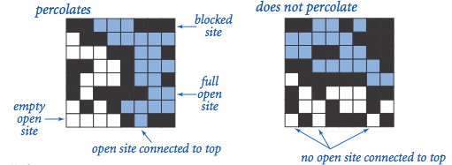
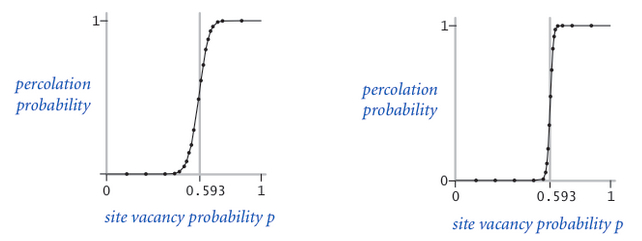
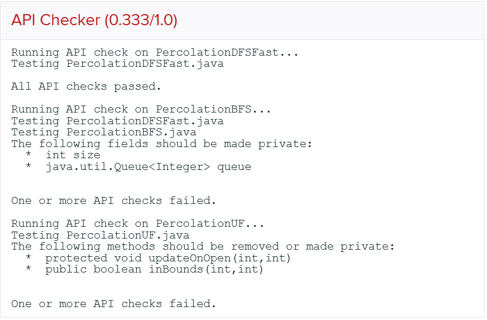

# Project 5: Percolation

This is the directions document for Project 5 Percolation in CompSci 201 at Duke University, Fall 2026.

**See [the details document](docs/details.md) for information** on using Git, starting the project, and more details about the project including information about the classes and concepts that are outlined briefly below. You'll absolutely need to read the information in the [details document](docs/details.md) to understand how the classes in this project work independently and together. The _details_ document also contains project-specific details. This current document provides a high-level overview of the assignment.

**You are STRONGLY encouraged to work with a partner on P5!** (and on P6 and P7). See [the details document](docs/details.md) for information on using Git with a partner and how the workflow can proceed. Ideally you can find a partner in your discussion section. Alternatively, you can use [this form to indicate interest](https://forms.cloud.microsoft/r/usRrXFDtnX).

*You can earn early engagement points as described below.*

## Project Introduction

In this assignment, you will write a program to estimate the value of the [percolation threshold](http://en.wikipedia.org/wiki/Percolation_thresholds) via [Monte Carlo](http://en.wikipedia.org/wiki/Monte_Carlo_method) simulation. In doing so, you will better understand depth-first-search, breadth-first-search, union-find structures, and the use of computer simulations for statistical inquiry. _**Your goal will be to explore trade-offs in several approaches to estimate the percolation threshold in an NxN system.**_ 

# Percolation Vocabulary and the Classes You Complete

In a system of rectangular/square NxN grid cells, each cell is sometimes referred to as a _site_ in the assignment and in supporting material, including this background.
- All sites start as **blocked**
- When a site is chosen at random it is **open**
- Open sites connected to the top row are **full**.
- A system in which there's a full cell in the bottom row (and thus a path of full cells from top to bottom) **percolates**.

Given a porous landscape with water on the surface (or oil below), under what conditions will the water be able to drain through to the bottom (or the oil to gush through to the surface)? Given a composite system composed of randomly distributed insulating and metallic materials, what fraction of the materials need to be metallic so that the composite system is an electrical conductor? Scientists have defined an abstract process known as percolation to model such situations.

We model a percolation system using an N-by-N grid of sites. **Each site is either open or blocked. A full site is an open site that can be connected to an open site in the top row via a chain of neighboring (left, right, up, down) open sites.** In diagrams we color full sites blue to model water flowing from the top through the system. We say the **system percolates if there is at least one full site in the bottom row.** In other words, a system percolates if there is a path of open sites from the top row to the bottom row. For the porous substance example, the open sites correspond to empty space through which water might flow, so that a system that percolates lets water fill open sites, flowing from top to bottom.

For more on percolation see the [Princeton Case Study](http://introcs.cs.princeton.edu/java/24percolation/).

## Percolation Threshold

**This project is a simulation.**

The percolation threshold problem is: if sites are independently set to be open with probability p (and therefore blocked with probability (1 − p), what is the probability that the system percolates? In other words, in a N-by-N grid, would the system percolate if N2 randomly chosen cells are opened?  When p equals 0, the system does not percolate; when p equals 1, the system percolates. The plots below show the site vacancy probability p versus the percolation probability for a 20-by-20 random grid (left) and 100-by-100 random grid (right).

When N is sufficiently large, there is a threshold value `p*` (read this as p-star) such that when `p < p*` a random N-by-N grid almost never percolates, and when `p > p*`, a random N-by-N grid almost always percolates. No mathematical solution for determining the percolation threshold `p*` has yet been derived. Your task is to write a suite of computer programs to visualize the percolation process and estimate `p*` using Monte Carlo techniques. As you can see above, the percolation threshold in an NxN grid is about 0.593. The size of the grid doesn't matter as your simulations will show. A hexagonal grid has a different threshold as your simulations will show.

### Helpful Videos 
The video [linked via this link](https://youtu.be/l4IyjqgYAT0) helps explain the techniques you'll read about (recorded for fall 2024). This video may be helpful after reading the assignment, or to get grounded before reading. This video may help situate the classes you write: `PercolationDFS`, `PercolationBFS`, and `PercolationUF`. 

### Acknowledgements 
This assignment originated at Princeton; thanks to Kevin Wayne from whom staff at Duke first learned of it, and to Jeff Forbes when he was at Duke for ensuring we kept it as part of the assignment-stack at Duke. We've revised it at Duke to be about trade-offs, DFS, BFS, and tangentially about Union-Find.

## Early Engagement Points (8)

Fork and clone the program and then run the `InteractivePercolationVisualizer`. Click the minimum number of squares until the grid percolates and record that number, call it $N$. Then determine how many different ways you can make the system percolate with only clicking $N$ squares.

Next, determine if it's possible to click on O(N2) squares _without_ the system percolating. Write a few sentences on how it's possible to do that, or write an argument that it's not possible. Hint: $N^2/2$ is O(N2), think about a chess board.

You'll submit the answers to these questions **and more** on [the form linked here](https://forms.cloud.microsoft/r/Tc3YkSCJnB). You must submit by midnight on November 16, for engagement points.

For this project, the grading will be:

| Points | Grading Criteria |
| --- | --- |
| 8 | PercolationDFS |
| 8 | PercolationBFS |
| 0 | PercolationUF (12 engagement/challenge) |
| 8 | Analysis  |

# Autograder API Checker
We use an API checker to check that you implement the appropriate instance variables and methods for each method. Attached below is a sample output response from a head UTA’s test submission. 

In order to resolve this issue, make sure that if you’ve added any instance variables or helper methods not specified in the writeup that you change them to private. 
