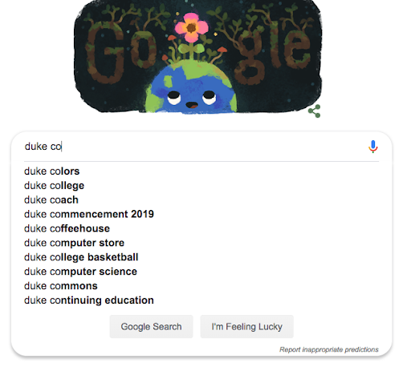
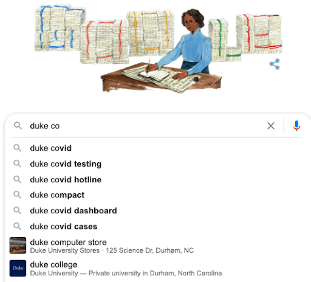
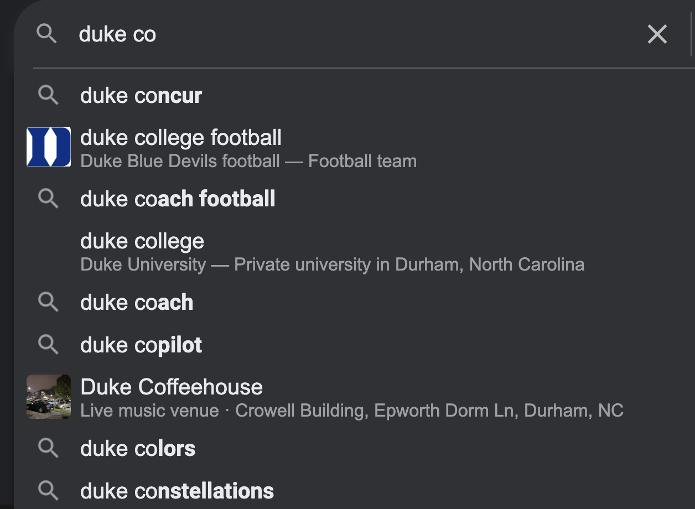
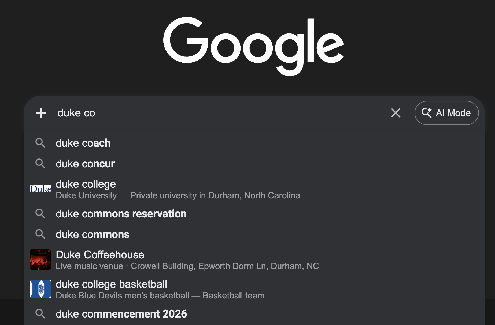

# Project 4: Autocomplete, Fall 2026

This is the overview document for Project 4 Autocomplete in CompSci 201 at Duke University, Fall 2026.

**See [the details document](docs/details.md) for information** on using Git, starting the project, and more details about the project including information about the classes and concepts that are outlined briefly below. You'll absolutely need to read the information in the [details document](docs/details.md) to understand how the classes in this project work independently and together. The _details_ document also contains project-specific details, this document provides a high-level overview of the assignment.

## Project Background and Concepts

Autocomplete is an algorithm used in many modern software applications. In all of these applications, the user types text and the application suggests possible completions for that text as shown in the example images below taken from google search.

The left/first was taken in March 2019, the right/second on October 9, 2020)

  
  

The screen shot below/left is from October 2025, and  March 2026 on the right.

  
  

Although finding terms that contain a query by searching through all possible results is possible, these applications need some way to select only the most useful terms to display (since users will likely not comb through thousands of terms, nor will obscure terms like "duke cookiemonster" be useful to most users). Thus, autocomplete algorithms not only need a way to find terms that start with or contain the prefix, but a way of determining how likely each one is to be useful to the user and displaying "good" terms first. This all needs to be done efficiently so that a user can see completions in real time.

In this project, you will leverage a `Comparator` in Java to implement a binary search that is better than Java's `Collections.BinarySearch`. You'll use this search on sorted data to implement an efficient autocompleter. Both of these implementations will use a `PriorityQueue` so you'll learn that API. You will create a second implementation based on a `HashMap`. You will then benchmark and analyze the tradeoffs of these implementations.  

According to one study, in order to be useful the algorithm must do all this in less than 100 milliseconds (see article linked below). If it takes any longer, the user will already be inputting the next keystroke (while humans do not on average input one keystroke every 50 milliseconds, additional time is required for server communication, input delay, and other processes). Furthermore, the server must be able to run this computation for every keystroke, for every user. In this assignment, you will be implementing autocomplete using three different algorithms and data structures. Your autocomplete will be different than the industrial examples described above in two ways:

1. Each term will have a predetermined, constant weight/likelihood, whereas actual autocomplete algorithms might change a term's likelihood based on previous searches.
2. We will only consider terms which start with the user query, whereas actual autocomplete algorithms (such as the web browser example above) might consider terms which contain but do not start with the query.

The article linked below describes one group's recent analysis of different data structures to implement autocomplete efficiently. You'll be implementing a version of what they call a prefix hash tree, though we'll use a prefix hash list which is more efficient when terms aren't updated dynamically.
- https://medium.com/@prefixyteam/how-we-built-prefixy-a-scalable-prefix-search-service-for-powering-autocomplete-c20f98e2eff1

## Engagement Points

Complete the questions on the [form linked here](https://forms.cloud.microsoft/r/08XWH2E6Wx) which include a short article on autocomplete as well as questions about the Prefixy medium post linked above. You can earn 10 engagement points by completing this before November 1.

### Acknowledgements
The assignment was originally developed by Kevin Wayne and Matthew Drabick at Princeton University for their Computer Science 226 class. Former head CompSci 201 UTAs, Arun Ganesh (Trinity '17) and Austin Lu (Trinity '15) adapted the assignment for Duke with help from Jeff Forbes. Josh Hug updated the assignment and provided more of the testing framework. Owen Astrachan added the prefix-hash-list (and removed the weighted trie).

## Submitting and Grading 

Push your code to Git. Do this often. Once you have run and tested your completed program locally:

1. Submit your code on gradescope to the autograder.
2. Submit a PDF to Gradescope in the separate Analysis assignment. Be sure to mark pages for the questions as explained in the [gradescope documentation here](https://help.gradescope.com/article/ccbpppziu9-student-submit-work#submitting_a_pdf).

### Grading

| Points | Grading Criteria |
| ------ | ------ |
| 4 | Code Comparator|
| 8 |  Code for BinarySearchLibrary firstIndex and lastIndex |
| 6 | Code for BinarySearchAutocomplete.topMatches |
| 9 | Code for HashListAutocomplete |
| 1 | API |
| 8 | Analysis code and questions answered. UTAs will grade and comment on this |

