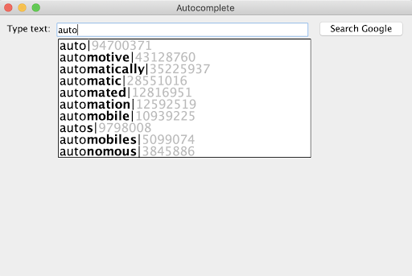

# P4 Autocomplete: Assignment Guide (Fall 2026)

This is a reorganized rewrite of [details.md](details.md). Read the [README](../README.md) first for the project overview and early engagement requirements. This guide covers the implementation work, testing, benchmarks, and analysis submission.

The original instructions remain unchanged. Corrections to wording and clarifications based on the starter code are identified where they affect interpretation.

## 1. Setup and workflow

Install Java, Git, and VS Code before starting. See the course's [software installation instructions](https://coursework.cs.duke.edu/201fall26/resources-201/-/blob/main/installingSoftware.md), which also describe alternatives for submitting without Git.

Use the [project workflow instructions](https://coursework.cs.duke.edu/201fall26/resources-201/-/blob/main/projectWorkflow.md) to fork and clone the starter repository, push updates to the course GitLab at [coursework.cs.duke.edu](https://coursework.cs.duke.edu), and submit code to Gradescope. Push your progress periodically, such as after completing a method or small section.

## 2. Work plan

Complete the work in this order. The original assignment recommends finishing the first three steps early.

| Step | Work | How to check it |
| --- | --- | --- |
| 1 | Run the supplied `BruteAutocomplete` implementation. | Launch `AutocompleteMain`; save a reference for the query `auto`. |
| 2 | Implement `PrefixComparator.compare`. | Run `TestTerm`. |
| 3 | Implement `BinarySearchLibrary.firstIndex` and `lastIndex`. | Run `TestBinarySearchLibrary` and `BinaryBenchmark`. |
| 4 | Complete `BinarySearchAutocomplete.topMatches` and connect the efficient search methods. | Run `TestBinarySearchAutocomplete`; compare GUI results with the reference. |
| 5 | Complete `HashListAutocomplete`. | Run the GUI with this implementation. The repository also provides `TestHashListAutocomplete`. |
| 6 | Run benchmarks, answer all four analysis questions, and submit. | Submit code and a separate analysis PDF to Gradescope. |

All three autocomplete classes implement `Autocompletor`. A `Term` contains a word and its weight. In general, `topMatches(prefix, k)` returns at most `k` matching terms in **descending weight order**. Return all matches if fewer than `k` exist, or an empty list if none exist. The hash-based implementation has a specific rule for long prefixes, described in Section 7.

## 3. Establish a GUI reference

1. Run the `main` method in `AutocompleteMain`.
2. Select `data/words-333333.txt`.
3. Enter `auto` and observe the suggested terms and weights.

The GUI initially uses `BruteAutocomplete`. A data file supplies both the possible completions and their weights, which represent popularity or frequency. Suggestions update as you type.

The original instructions say that a terminal/console warning about *Secure Coding* can be ignored when running the GUI.

Use the same file and query to check each implementation you complete. Its terms and weights should match the brute-force reference:

<div align="center">
  
</div>

To switch implementations, change `AUTOCOMPLETOR_CLASS_NAME` near the start of `AutocompleteMain`. Keep exactly one assignment active:

```java
final static String AUTOCOMPLETOR_CLASS_NAME = BRUTE_AUTOCOMPLETE;
//final static String AUTOCOMPLETOR_CLASS_NAME = BINARY_SEARCH_AUTOCOMPLETE;
//final static String AUTOCOMPLETOR_CLASS_NAME = HASHLIST_AUTOCOMPLETE;
```

## 4. Implement `PrefixComparator.compare`

`PrefixComparator.getComparator(r)` creates a comparator whose prefix limit is `r`, stored in `myPrefixSize`. Implement its `compare(Term v, Term w)` method.

### Comparison rules

Compare the words lexicographically, considering at most the first `r` characters of each word:

1. Examine corresponding characters until you find a difference, reach the prefix limit, or reach the end of either word.
2. If characters differ, return a negative or positive value according to their order.
3. If all examined characters match and you reached the prefix limit, return zero. Characters beyond the limit do not matter.
4. If a word ends before the prefix limit and all examined characters match, the shorter word comes first. If both words have the same length, they compare equal.

Equivalently, when no differing character is found, compare the lengths capped at `r`: `min(word.length(), r)`. This explains why a short word can compare equal at one prefix limit and less than another word at a larger limit.

| Prefix limit | First word | Result | Second word | Explanation |
| --- | --- | --- | --- | --- |
| 4 | `bee` | < | `beekeeper` | `bee` ends before the limit. |
| 4 | `bees` | > | `beek` | `s` comes after `k`. |
| 4 | `bug` | > | `beeswax` | `u` comes after `e`. |
| 4 | `bees` | = | `beeswax` | Both begin with `bees`. |
| 3 | `beekeeper` | = | `beeswax` | Both begin with `bee`. |
| 3 | `bee` | = | `beeswax` | The three-character limit is reached. |

### Required implementation approach

Use a loop and `charAt` to inspect **only as many characters as needed**. Stop as soon as the result is known. You may compare characters with `<` and `>` or subtract them to obtain a signed result.

Run the `PrefixComparator` tests in `TestTerm`.

## 5. Implement `BinarySearchLibrary`

Implement these generic utility methods using the supplied comparator:

| Method | Required result |
| --- | --- |
| `firstIndex(list, target, comp)` | Smallest index `i` for which `comp.compare(list.get(i), target) == 0`. |
| `lastIndex(list, target, comp)` | Largest index `i` for which that comparison is zero. |

Return `-1` when no matching element exists. The list must be sorted consistently with the comparator. Here, “matching” means comparator equality; it does not require identical objects or identical full words.

### Performance requirement

Both methods must use binary search and run in **O(log N)** time, where `N` is the list length. The stated comparison bound is **1 + ceil(log2 N)** for a nonempty list.

The supplied `firstIndexSlow` and `lastIndexSlow` return correct results, but can scan linearly through matching elements. They do not meet the performance requirement. An ordinary binary search, such as `BinaryBenchmark.bsearch`, is logarithmic but may return any matching index, so it also does not satisfy the full requirement.

### `firstIndex`: search for the left boundary

Use the approach in `BinaryBenchmark.firstMatch`. The original instructions explicitly permit copying that method's approach into `firstIndex`.

Maintain a candidate interval **(low, high]** for the first match, if one exists. The left endpoint is excluded; the right endpoint is included.

- Start with `low = -1` and `high = list.size() - 1`.
- All indices at or below `low` have been ruled out because their values are less than the target.
- Compute the midpoint as `low + (high - low) / 2`.
- If `comp.compare(list.get(mid), target) < 0`, move `low` to `mid`.
- Otherwise, move `high` to `mid`, including when the comparison is zero. Continue searching toward the first match.
- Stop when the endpoints differ by one: `while (low + 1 != high)`.
- After the loop, check that `high` is a valid index and that its value compares equal to the target. Return `high` if so; otherwise return `-1`.

**Starter-code clarification:** `BinaryBenchmark.firstMatch` is specialized to strings and uses `compareTo` for its final equality check. The generic library method must use the supplied `comp` for that check, as well as for comparisons inside the loop. Do not copy the string-specific check unchanged.

### `lastIndex`: search for the right boundary

Develop the corresponding algorithm using the interval **[low, high)** for the last match, if one exists. This interval is closed on the left and open on the right.

- Start with `low = 0` and `high = list.size()`.
- Values at or beyond `high` have been ruled out because they are greater than the target.
- Adjust the endpoints according to the comparator, preserving the last possible match and halving the search interval each time.
- Continue searching after finding an equal value so you can locate the last match.
- When the endpoints differ by one, check that `low` is valid and that its value compares equal to the target. Return `low` if so; otherwise return `-1`.

The original text mistakenly calls this interval “open on the left.” It is **open on the right**. For both methods, handle an empty list before entering a loop that assumes a nonempty candidate interval.

### Verify correctness and comparison counts

Run `TestBinarySearchLibrary`, then use `BinaryBenchmark`:

1. In `firstResults`, replace the call to `firstMatch` with `BinarySearchLibrary.firstIndex` to benchmark your implementation.
2. Enable `lastResults` in `BinaryBenchmark.main` to benchmark `lastIndex`.
3. Confirm that `sdex` (the slow method's index) and `fdex` (the fast method's index) agree.
4. Compare `scomps` and `fcomps`, the comparison counts. The fast method's counts should grow logarithmically.

**Benchmark clarification:** the printed `size` in this starter benchmark is the number of repetitions of each word. `createList(size)` contains ten different words repeated that many times, so its actual list length is `10 * size`. Use the actual list length for `N` when checking the comparison bound.

## 6. Complete `BinarySearchAutocomplete`

The supplied initialization code stores `Term` objects in `myTerms` and sorts them lexicographically. Terms matching a prefix therefore occupy a contiguous range.

### Connect your efficient search methods

Update the helper methods:

- `firstIndexOf` should call `BinarySearchLibrary.firstIndex`, replacing `firstIndexSlow`.
- `lastIndexOf` should call `BinarySearchLibrary.lastIndex`, replacing `lastIndexSlow`.

These helpers convert the `Term[]` to a `List<Term>` using `Arrays.asList` because the library methods take lists.

### Complete `topMatches(prefix, k)`

The provided code creates a dummy `Term` from `prefix` and a comparator whose prefix length is `prefix.length()`. The dummy term's weight is irrelevant because this comparator uses only words.

The calls to `firstIndexOf` and `lastIndexOf` locate the matching range. If no match exists, return an empty list. Otherwise:

1. Examine only the terms from `first` through `last`, inclusive.
2. Maintain a priority queue containing at most the `k` heaviest terms seen so far, using the approach in `BruteAutocomplete.topMatches`.
3. Return those terms in descending weight order. Return fewer than `k` if fewer matches exist.

**Use the size-limited priority queue approach.** Sorting all matching terms is discussed in the original instructions for comparison, but is not the approach you are asked to implement.

### Expected runtime

Let `N` be the total number of terms, `M` the number matching the prefix, and `k` the requested number of results.

| Operation | Runtime |
| --- | --- |
| Find the first and last matching indices | O(log N) |
| Process the matching range with a size-limited priority queue | O(M log k) |
| Remove and order up to `k` results | O(k log k) |

The assignment summarizes this approach as **O(log N + M log k)**, rather than **O(log N + M log M)** for sorting all matches. These logarithmic expressions describe the usual positive-`k` case; fewer than `k` results may exist.

Run `TestBinarySearchAutocomplete`. Then switch the GUI to `BinarySearchAutocomplete` and compare its `auto` results with the brute-force reference.

## 7. Complete `HashListAutocomplete`

Use the supplied skeleton to implement a third `Autocompletor`. This implementation precomputes weight-sorted lists for prefixes and stores them in a hash map. It trades additional initialization work and memory for fast queries.

The work consists of a **constructor and three methods**: `initialize`, `topMatches`, and `sizeInBytes`. The original text says “four methods” but lists these three methods in addition to the constructor.

Add these fields:

```java
private static final int MAX_PREFIX = 10;
private Map<String, List<Term>> myMap;
private int mySize;
```

### Constructor

Create a constructor taking `String[] terms` and `double[] weights`, following the other implementations. Check invalid input, initialize `myMap`, and call `initialize(terms, weights)`.

As a concrete model, `BruteAutocomplete` rejects null arrays with `NullPointerException`, unequal array lengths with `IllegalArgumentException`, and negative weights or duplicate words with `IllegalArgumentException` during initialization. The supplied hash-list tests explicitly check null arrays and unequal lengths.

### `initialize`: build and sort the prefix lists

For each input term:

1. Create its `Term` object. Ideally, create it once and reuse references to it across lists.
2. Generate prefixes of every length from **0 through min(word.length(), MAX_PREFIX), inclusive**.
3. For each prefix, add the term to the corresponding `ArrayList` in `myMap`, creating the list if needed.

**Always include the empty string.** Its list contains every term.

For example, `("hippopotamus", 40)` belongs to the lists for:

```text
"", "h", "hi", "hip", "hipp", "hippo", "hippop",
"hippopo", "hippopot", "hippopota", "hippopotam"
```

The last prefix has ten characters. There are **11 prefixes**, including the empty string. `MAX_PREFIX` limits prefix length, not the number of prefixes; the original “up to 10 substrings” wording is incorrect.

After adding all terms, sort **every list** from highest to lowest weight using the required comparator:

```java
Collections.sort(list, Comparator.comparing(Term::getWeight).reversed());
```

For example:

| Prefix | Stored terms in descending weight order |
| --- | --- |
| `ch` | `("chat", 50)`, `("chomp", 40)`, `("champ", 30)`, `("chocolate", 10)` |
| `cho` | `("chomp", 40)`, `("chocolate", 10)` |
| `cha` | `("chat", 50)`, `("champ", 30)` |

### `topMatches`: look up a precomputed list

1. If the query prefix is longer than `MAX_PREFIX`, truncate it to its first ten characters.
2. Look up the resulting prefix in `myMap`.
3. If absent, return an empty list.
4. Otherwise, return the first `min(k, all.size())` entries of its already sorted list:

```java
List<Term> list = all.subList(0, Math.min(k, all.size()));
```

Truncation is an explicit assignment requirement: characters after the tenth do not further restrict this implementation's results.

The assignment describes this query as **O(1)** because the prefix length is bounded, hash-map lookup takes expected constant time, and `subList` returns a view without copying all results. Iterating over or copying the returned results still takes time proportional to the number of entries visited or copied.

### `sizeInBytes`: estimate stored data

Return an estimated byte count for the map's string keys and term data, using the constants in `Autocompletor`:

| Data | Estimated bytes |
| --- | --- |
| A string of length `L` | `BYTES_PER_CHAR * L` (`2 * L`) |
| A term's weight | `BYTES_PER_DOUBLE` (`8`) |

Count each distinct map key once. A term's estimated data size is its word's character bytes plus its weight's bytes. This is the assignment's simplified estimate, rather than a full Java heap measurement.

You may accumulate the count in `mySize` during initialization and return it directly, or compute it on the first `sizeInBytes` call and cache it for later calls.

**Memory-counting ambiguity in the original:** one passage suggests counting each shared `Term` once, while another says to count every term occurrence in every prefix list. The supplied `TestHashListAutocomplete.testSizeInBytes` explicitly accepts both interpretations (312 or 950 bytes for its sample input) and comments that both are accepted on Gradescope. Whichever interpretation you use, count distinct prefix keys once and apply your term-counting rule consistently.

Run the available `TestHashListAutocomplete` tests and compare the GUI's `auto` results with the brute-force reference.

## 8. Benchmarks and written analysis

Submit your analysis as a **PDF separate from your code** in Gradescope. Label the pages for each analysis question. You may use the supplied [analysis template](p4-analysis-template.docx).

### Benchmark setup and output

The actual class and file in this repository are named **`BenchMarkForAutocomplete`** and `src/BenchMarkForAutocomplete.java`. The original instructions use several inconsistent spellings of this name.

In `myCompletorNames`, enable all three implementation names:

```java
"BruteAutocomplete",
"BinarySearchAutocomplete",
"HashListAutocomplete"
```

The original instructions allow benchmarking a subset if an implementation is not working; leave those names commented out as needed.

Change the input filename in `doMark`. Change `matchSize` in `runAM` to control `k`; its initial value is 50.

| Output | Meaning |
| --- | --- |
| `init time` | Initialization time for an implementation, in seconds. |
| `search` | Query prefix. A blank entry means the empty string `""`. |
| `size` | Number of terms matching the prefix (`M`). |
| `#match` | Requested maximum number of results (`k`); the actual result can be smaller. |
| Implementation columns | Time in seconds for that implementation's `topMatches` call. |
| `size in bytes` | The implementation's estimated storage from `sizeInBytes`. |

`threeletterwords.txt` contains all three-letter combinations from `aaa` to `zzz`, not just dictionary words. Exact timings vary by computer; the example timings in the original document are illustrative.

### Question 1: Benchmark all three datasets

Run `BenchMarkForAutocomplete` once for each file:

1. `data/threeletterwords.txt`
2. `data/fourletterwords.txt`
3. `data/alexa.txt`

Use `matchSize = 50` for these baseline runs. Copy and paste **all three sets of results** into your analysis.

### Question 2: Explain the empty-prefix timings

Use these definitions and stated runtimes:

- `N`: total number of terms.
- `M`: number of terms matching the query prefix (`size`).
- `k`: requested number of highest-weight results (`#match`).
- `BruteAutocomplete`: O(N + M log k).
- `BinarySearchAutocomplete`: O(log N + M log k).

Explain why the brute-force implementation can be similarly fast or slightly faster than the binary-search implementation for the empty prefix `""`. Discuss the relationship between `N` and `M` for that query and the work performed by each algorithm. Is the observation merely an anomaly from small measured times, or is there an algorithmic reason? The original hint is to consider how many terms match the empty prefix.

### Question 3: Change the number of requested results

Run the benchmark again with `data/alexa.txt`, changing `matchSize` in `runAM` from 50 to **100**. Copy and paste the results into your analysis.

Compare them with the `k = 50` results. Do the measurements support the hypothesis that runtime depends logarithmically on `k` for `BruteAutocomplete` and `BinarySearchAutocomplete`? Explain using your data.

### Question 4: Explain the hash-map tradeoff

Briefly explain why `HashListAutocomplete` has much faster measured `topMatches` queries but uses more memory than the other implementations.

## 9. Submission checklist

- Complete `PrefixComparator.compare`.
- Complete the efficient `BinarySearchLibrary.firstIndex` and `lastIndex` methods.
- Connect those methods to `BinarySearchAutocomplete` and finish its priority-queue implementation of `topMatches`.
- Complete the `HashListAutocomplete` constructor, initialization, queries, and byte estimate.
- Run the relevant JUnit tests, the binary-search benchmark, and the GUI comparisons.
- Include the three baseline benchmark outputs and the additional Alexa run with `k = 100` in your analysis.
- Answer all four analysis questions.
- Submit code and a separate, appropriately labeled analysis PDF through the course submission workflow.
